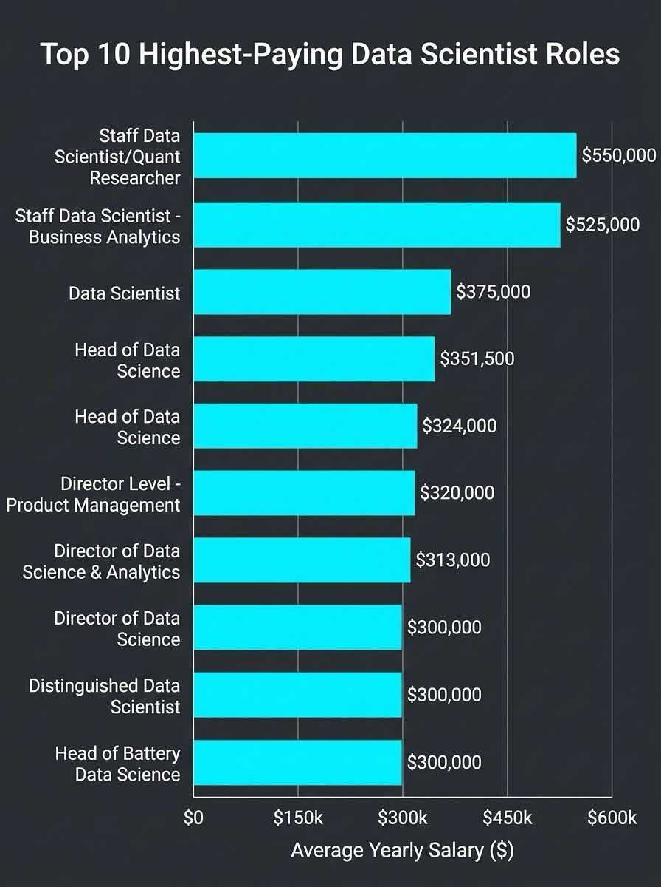

# 🤖 Introduction
🚀 **Ready to explore the data science job market?** This project breaks down the data scientist landscape to uncover 💰 **the highest-paying roles**, 🔥 **essential in-demand skills**, and 📈 **the perfect sweet spot where industry demand meets competitive salaries.**

🔍 **SQL queries?** Check them out here: [project_sql folder ](/project_sql/)
# 🌍 Background
Driven by a quest to navigate the competitive data science job market more effectively, this project was born from a desire to pinpoint top-paid roles and highly sought-after technical skills. By analyzing real-world job posting data, this project aims to streamline the job hunt and help professionals focus on learning the most optimal skills.

The analysis is built using a comprehensive data science job market dataset containing detailed insights on over thousands of job listings, including job titles, salaries, locations, and essential skill tags.

### ❓ The questions I wanted to answer through my SQL queries were:
1. What are the top-paying data scientist jobs?
2. What skills are required for these top-paying jobs?
3. What skills are most in demand for data scientists?
4. Which skills are associated with higher salaries?
5. What are the most optimal skills to learn?
# Tools Used
For this deep dive into the data science job market, the following technical stack was utilized:

* **SQL:** Serving as the backbone of the analysis to query the database and extract critical insights.
* **PostgreSQL:** Selected as the relational database management system to structure and handle the job posting data.
* **Visual Studio Code:** Utilized as the primary integrated development environment (IDE) for executing queries and managing scripts.
* **Git & GitHub:** Employed for version control, repository hosting, and documentation management.
# The Analysis
Each query for this project aimed at investigating specific aspects of the data scientist job market. Here's how I approached each question:

### 1. Top Paying Data Scientist Jobs
To identify the highest-paying roles, I filtered data scientist positions by average yearly salary and location, focusing on remote jobs. This query highlights the high-paying opportunities in the field.
```sql
select  
    job_id,
    job_title,
    job_location,
    job_schedule_type,
    salary_year_avg,
    job_posted_date,
    name as company_name
FROM
     job_postings_fact JOIN company_dim ON
     job_postings_fact.company_id=company_dim.company_id
WHERE
     job_title_short='Data Scientist'
     and job_location='Anywhere' AND
     salary_year_avg is NOT NULL
ORDER BY
    salary_year_avg DESC
LIMIT 10;
```
Here's the breakdown of the top data scientist jobs in 2023:

* **Wide Salary Range:** The top 10 paying data scientist roles span from $300,000 to $550,000, indicating highly significant earning potential at the peak of the field.
* **Diverse Employers:** Leading firms such as Selby Jennings, Demandbase, Algo Capital Group, Reddit, and Walmart are among those offering these premier salaries, showing substantial financial backing across quantitative research, tech platforms, and retail giants.
* **Job Title Variety:** There is a strong diversity in seniority and focus among the highest-earning titles, ranging from specialized individual contributor tracks like Staff Data Scientist/Quant Researcher and Distinguished Data Scientist to executive leadership positions such as Head of Data Science and Director of Data Science.


*Bar graph visualizing the salary for the top 10 salaries for data scientist; ChatGPT generated this graph from my SOL query results*
I

### 2. Skills Required for Top-Paying Data Scientist Jobs
To understand what tools and technologies command a premium in the market, this query analyzes the specific technical skills demanded by the highest-paying roles identified in the previous step. It reveals the core technical stack required to break into elite salary tiers.
```sql
with top_paying_jobs as(
select  
    job_id,
    job_title,
    salary_year_avg,
    name as company_name
FROM
     job_postings_fact JOIN company_dim ON
     job_postings_fact.company_id=company_dim.company_id
WHERE
     job_title_short='Data Scientist'
     and job_location='Anywhere' AND
     salary_year_avg is NOT NULL
ORDER BY
    salary_year_avg DESC
LIMIT 10
 )

 SELECT DISTINCT
     t.job_id,
     t.job_title,
     t.salary_year_avg,
     t.company_name,
     string_agg(s.skills,', ') as skills
 from 
     top_paying_jobs t JOIN skills_job_dim sj
     on t.job_id=sj.job_id JOIN skills_dim s
     on sj.skill_id=s.skill_id
GROUP BY
     t.job_id,
     t.job_title,
     t.salary_year_avg,
     t.company_name

ORDER BY
     t.salary_year_avg DESC  
LIMIT 10
```
Here are the findings for the skills required in top-paying data scientist roles in 2023:

* **Core Programming Foundations:** Python and SQL remain foundational tools across nearly all top-paying roles, demonstrating that strong database querying skills and programming flexibility are standard baseline expectations at elite salary brackets.
* **Deep Learning and Machine Learning Frameworks:** High-paying positions heavily emphasize advanced modeling frameworks, with tools like TensorFlow, PyTorch, Keras, and Scikit-Learn appearing regularly for model development and optimization.
* **Cloud Infrastructure Proficiency:** Familiarity with cloud platforms is prominently required, with multi-cloud skills spanning AWS, GCP, and Azure to support scalable data workflows and infrastructure deployment.
* **Big Data and Distributed Computing Tools:** Ecosystems designed for large-scale data processing—such as Spark, Hadoop, Cassandra, and deployment tools like Kubernetes—are highly favored by firms offering premium compensation packages.


*Bar graph visualizing the skills for the top paid data scientists; ChatGPT generated this graph from my SOL query results*

### 3. Skills Most in Demand for Data Scientists

To identify the most demanded skills, I joined the job postings table with the skills dim table, filtered explicitly for 'Data Scientist' roles, and aggregated the total count of job postings grouped by each skill tag. I then sorted the results in descending order to isolate the top 5 most requested competencies globally.

```sql
select 
    skills,
    count(sj.job_id) as demand_count
from 
     job_postings_fact j JOIN skills_job_dim sj
     on j.job_id=sj.job_id JOIN skills_dim s
     on sj.skill_id=s.skill_id
WHERE
    job_title_short='Data Scientist' AND
    job_location='Anywhere'
GROUP BY
     skills
order by 
    demand_count DESC
limit 5
```
* **Dominance of Python:** Python is the single most demanded skill by a massive margin, appearing in 10,390 job postings. This highlights its status as the absolute industry standard for data science scripting, machine learning modeling, and workflow automation.
* **Core Database Proficiency:** SQL ranks as the second most requested skill with 7,488 mentions. This underscores that enterprise-level data retrieval, manipulation, and database management remain an indispensable core baseline requirement.
* **Statistical Foundations:** R remains a significant competitor in market demand with 4,674 listings, proving that specialized statistical analysis frameworks still hold a strong position alongside general-purpose programming languages.
* **Cloud Infrastructure Baseline:** AWS leads the cloud platform requirements with 2,593 mentions, indicating that companies heavily value data scientists who can navigate, scale, and deploy models directly within cloud environments.
* **Enterprise Reporting and Visualization:** Tableau rounds out the top five with 2,458 mentions, confirming that clear business intelligence delivery, executive dashboarding, and data storytelling are essential competencies.


*Bar graph visualizing the top demanded skills for  data scientists; ChatGPT generated this graph from my SOL query results*

### 4. Highest-Paying Skills for Data Scientists

To identify which skills command the highest premium, I joined the core job facts table with the skills dimension table and filtered for postings matching 'Data Scientist'. I excluded entries without a listed salary, aggregated the average annual salary grouped by each skill tag, and sorted the output in descending order to isolate the top highest-paying skills.

```sql
select 
    skills,
    round(avg(salary_year_avg),2) as average_salary
from 
     job_postings_fact j JOIN skills_job_dim sj
     on j.job_id=sj.job_id JOIN skills_dim s
     on sj.skill_id=s.skill_id
WHERE
    job_title_short='Data Scientist' AND
    salary_year_avg IS NOT NULL AND
    job_location='Anywhere'
GROUP BY
     skills
order by 
    average_salary DESC
limit 25
```

* **Niche Compliance Commands Top Dollar:** GDPR expertise sits at the absolute peak of the data science salary landscape with an average annual compensation of $217,737.50. This demonstrates that specialized regulatory, governance, and data privacy skills command a highly significant financial premium over standard tools.
* **Premium Backend Scripting:** Golang emerges as the second highest-paying skill at $208,750.00. This underlines a growing corporate willingness to pay top-tier salaries for data scientists capable of building high-performance, concurrent data pipelines and backend production services.
* **Specialized System Infrastructure:** Collaboration and continuous deployment technologies like Atlassian tools ($189,700.00) alongside robust automation frameworks like Selenium ($180,000.00) reveal that data engineering, automation, and project architecture synchronization carry an immense premium.
* **Advanced Computer Vision and Graph Datasets:** Specialized engineering domains such as OpenCV for computer vision ($172,500.00) and Neo4j for graph databases ($171,655.00) show up prominently, highlighting that advanced mathematical modeling and unique relational infrastructure are heavily rewarded by employers.

| Skill | Average Salary ($) |
| :--- | :--- |
| gdpr | 217,737.50 |
| golang | 208,750.00 |
| atlassian | 189,700.00 |
| selenium | 180,000.00 |
| opencv | 172,500.00 |
| neo4j | 171,655.00 |
| microstrategy | 171,146.58 |
| dynamodb | 169,670.33 |
| php | 168,125.00 |
| tidyverse | 165,512.50 |
| solidity | 165,000.00 |
| c | 164,864.98 |

### 5. Optimal Skills to Learn for Data Scientists

To identify the most optimal skills to pursue—where high market demand intersects with competitive compensation—I analyzed skills with more than 10 job postings. By combining demand counts with average yearly salaries for 'Data Scientist' roles, this query highlights the highest-value technical competencies for strategic career growth.

```sql
select 
    s.skill_id,
    s.skills,
    count(sj.job_id) as demand_count,
    round(avg(salary_year_avg),2) as average_salary
from 
     job_postings_fact j JOIN skills_job_dim sj
     on j.job_id=sj.job_id JOIN skills_dim s
     on sj.skill_id=s.skill_id
WHERE
    job_title_short='Data Scientist' AND
    salary_year_avg IS NOT NULL AND
    job_location='Anywhere'
GROUP BY
    s.skill_id
Having 
    count(sj.job_id)>10
ORDER BY
    demand_count DESC,
    average_salary DESC
```
* **The High-Demand Python Standard:** Python represents the ultimate baseline skill for any data scientist, combining an enormous market demand of 763 mentions with a strong, highly competitive average salary of $143,827.81.
* **Essential Cloud and Big Data Premiums:** Cloud and distributed computing infrastructure offer exceptional returns. AWS leads the cloud category with a high demand count of 217 listings paired with a stellar $149,629.95 average salary, closely tracked by Spark at 149 mentions commanding $150,188.49.
* **Advanced Modeling Frameworks:** Deep learning and machine learning specializations continue to hold immense value. PyTorch yields a premium average salary of $152,602.70 with a solid 115 listings, outstripping TensorFlow ($142,305.63 across 126 listings) in compensation value.
* **Data Manipulation & Machine Learning Core:** Core analytical libraries remain fundamental gatekeepers to enterprise roles. Pandas shows healthy integration across 113 job postings with a $144,815.95 average return, while Scikit-Learn commands an average salary of $148,863.05 across 81 postings.

| Skill | Demand Count | Average Salary ($) |
| :--- | :--- | :--- |
| python | 763 | 143,827.81 |
| sql | 591 | 142,833.12 |
| r | 394 | 137,885.31 |
| tableau | 219 | 146,979.65 |
| aws | 217 | 149,629.95 |
| spark | 149 | 150,188.49 |
| tensorflow | 126 | 142,305.63 |
| pytorch | 115 | 152,602.70 |
| pandas | 113 | 144,815.95 |
| sas | 110 | 129,919.88 |
| hadoop | 82 | 143,321.50 |
| scikit-learn | 81 | 148,863.05 |
| excel | 77 | 128,234.44 |
# What I Learned
Throughout this analysis project, I have significantly advanced my technical database capabilities and market assessment skills:

* **Complex Query Crafting:** Mastered advanced SQL techniques, including multi-table JOIN structures and complex Common Table Expressions (CTEs) to segment, isolate, and aggregate multi-layered job market features.
* **Data Aggregation and Wrangling:** Utilized group functions, conditional filtering, and rounded mathematical aggregations to transform raw job postings and skill dimension rows into clear macro-market metrics.
* **Analytical Problem Solving:** Developed real-world data science strategy workflows, translating broad career questions into programmatic, executable SQL inquiries to reveal hidden economic premiums.
# Conclusions
### Insights

1. **Top-Paying Data Scientist Jobs**: The highest-paying jobs for data scientists that allow remote work offer an exceptionally competitive range of salaries, with peak compensation reaching up to $550,000 for top-tier specialized tracks.
2. **Skills for Top-Paying Jobs**: High-paying data scientist positions require deep specialized proficiency, explicitly demanding advanced machine learning frameworks like TensorFlow and PyTorch alongside scalable cloud architecture stacks.
3. **Most In-Demand Skills**: Python stands as the absolute most heavily demanded technical competency across the data scientist market landscape, solidifying its position as an essential baseline skill for all active job seekers.
4. **Skills with Higher Salaries**: Highly specialized compliance fields like GDPR, performant infrastructure languages like Golang, and automation frameworks like Selenium carry the highest average market salaries, indicating an immense financial premium on niche engineering expertise.
5. **Optimal Skills for Job Market Value**: Python and SQL aggressively dominate both total market demand and competitive salary returns simultaneously, positioning them as the most critical skills to master for maximizing immediate career value.
### Closing Thoughts

This project enhanced my SQL skills and provided valuable insights into the data science job market. The findings from the analysis serve as a guide to prioritizing skill development and job search efforts. Aspiring data scientists can better position themselves in a competitive job market by focusing on high-demand, high-salary skills. This exploration highlights the importance of continuous learning and adaptation to emerging trends in the field of data science.
